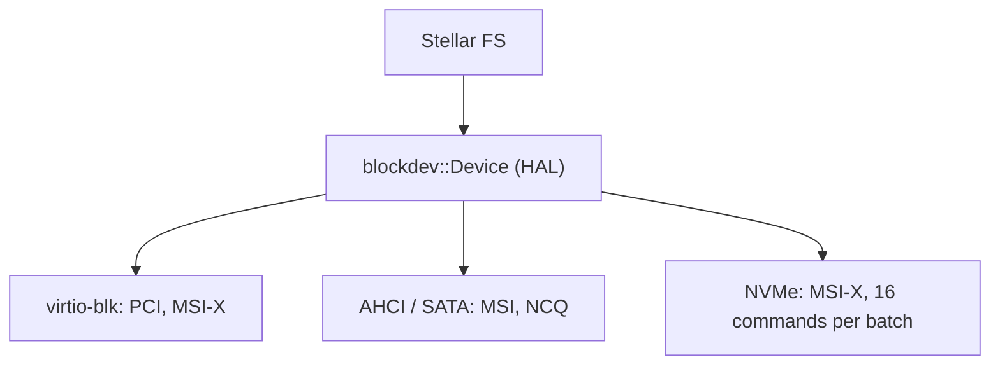

# Architecture

How the kernel is built today. For where it is going, see the [README](../README.md).

## The "Cosmos" naming model

Every subsystem shares one naming scheme instead of generic OS-dev vocabulary, and the
metaphor maps onto the real mechanics:

| Subsystem | Term | Meaning |
|---|---|---|
| Physical memory | **Universe** | Buddy allocator (`mm/pmm.cpp`) |
| Kernel allocations | **Kernel heap** | Slab classes over Universe (`mm/kheap.cpp`), backs `new` and `delete` |
| | Galaxy / Orbit / Planet | A firmware-reported region / one buddy free list / one allocated block |
| Virtual memory | **Constellation** | An address space (one PML4); *The Core* is the kernel's own |
| Scheduler | **Orbital** | MLFQ scheduler (`sched/orbital.cpp`) |
| | Sun / Satellite / Orbit | A core / a kernel thread / a priority ring (4 of them) |
| Filesystem | **Stellar FS** | Graph-based COW filesystem (`fs/stellar.cpp`) |
| | Star / Constellation | Any object (file or directory) / a directory |

### Boot sequence

### Memory

**Physical (`Universe`).** Real buddy split and coalesce, spinlock-protected so every core
can allocate concurrently. DMA buffers are tracked in a table sorted by address, so turning a pointer back into a
physical address is a binary search and a foreign pointer is refused.

**Kernel heap (`kheap`).** `kheap::alloc` and `kheap::free` sit on top of Universe, and `operator new` and
`operator delete` (`mm/new.cpp`) call them. Requests up to 2048 bytes come from 14 size classes (16, 32, 48, 64, 96, 128,
192, 256, 384, 512, 768, 1024, 1536, 2048). Each class has its own lock and a list of slabs that still have free
objects; a slab is 1 to 4 pages taken from Universe, carries a 64-byte header, and holds at least four objects.
Larger requests take exactly the pages they need straight from Universe: the buddy block is rounded up to a power of
two, and the unused tail is handed back at once. A one-`u32`-per-page map records which pages belong to a slab class
and where a large block starts, so `free` needs no size argument and rejects anything it never handed out. Freed
objects are filled with `0xDD`; the next allocation of that object checks the fill, so a write to freed memory stops
the kernel with a message instead of corrupting something later. Freeing an object twice, freeing the middle of an
object, freeing a large block twice and freeing a pointer the heap does not own are all fatal. Every pointer is
16-byte aligned; larger alignments are not supported and `operator new` has no aligned form, so asking for one fails to
link instead of misbehaving. `operator new` stops the kernel when memory runs out (there are no exceptions), while
`kheap::alloc` returns `nullptr`. A slab that becomes empty goes back to Universe unless it is the only one with free
space in its class. `kheap::stats()` reports live objects and bytes, slab and large-block pages, call counts and
failed allocations. Nothing in the kernel allocates from it yet except its own tests; the Nebula VFS and the shell will.

**Virtual (`Constellation`).** The Core is built fresh instead of continuing on Limine's
tables (`mm/vmm.cpp`): reusing bootloader-reclaimable memory before replacing the tables that
point into it is a real use-after-free.

**Everything after boot is SMP-safe.** One lock covers all page-table edits. Changing or removing an existing
mapping (`map_*` over a present entry, `unmap`, `protect`, replacing a page table) ends in a TLB shootdown
(`arch/x86_64/tlb.cpp`): the editing core publishes the range, sends a fixed IPI (vector `0x30`) to every other
core that can hold the translation, and waits for each to acknowledge before it frees anything. Adding a mapping
where there was none needs no shootdown. Cores that spin on either lock keep servicing pending shootdowns, so two
cores can never wait on each other with interrupts off. A core joins the set once its IDT and APIC are up
(`tlb::init_core()`), and the boot self-test proves the protocol: every core reads a page, the page is remapped,
protected and unmapped, and every core must see the change at once.

**Address spaces.** `constellation::Space` is one PML4. All 256 kernel-half slots are populated at boot and copied
into every new space, so a later kernel mapping is visible in all of them without touching any space. User spaces
(`create_space`, `space_map`, `space_unmap`, `space_protect`, `activate`, `destroy_space`) only accept addresses
below `USER_LIMIT`, set the U/S bit at every level, and refuse writable+executable mappings. A user-space change
only shoots down the cores that currently have that space loaded. Nothing runs in ring 3 yet; this is the groundwork.

**Firmware tables.** The direct map no longer aliases reserved memory above 4 GiB. `map_firmware()` hands out a
pointer for any physical range: the direct-map address when it is already covered, otherwise an uncached,
read-only, non-executable window at `FIRMWARE_REGION_BASE`. ACPI parsing goes through it.

**Memory map size.** The kernel copies at most 512 memory-map entries from the bootloader. If the firmware reports more, the
boot stops with a message instead of quietly dropping the rest.

**Known limits.** Firmware windows made by `map_firmware()` are never unmapped, and the window has a fixed budget. Page tables
emptied by `unmap` are not freed. There is no page-fault handler yet, so any fault is a panic. Physical frames have no
reference counts, so nothing can be shared copy-on-write. The DMA table holds at most 256 live buffers.

**Per-core protections.** Besides NX, WP and PAT, each core turns on SMEP and SMAP when the CPU has them. SMAP is
safe today because the kernel never touches user addresses; the copy-from-user path will need `stac`/`clac`.

### Scheduler (Orbital)

Four rings with growing slices (2, 4, 8, 16 ticks of 10 ms) and a CPU allotment per ring (8, 16, 32 ticks; the last
ring has none). A Satellite is demoted when it has used its ring's allotment, whether or not it yielded in between,
so a task cannot stay in the top ring by yielding just before its slice ends. `yield()` no longer promotes anything.
A Satellite that slept for at least five ticks moves up one ring on wake; short sleeps change nothing. Every 50 ticks
each core boots everything back to the top ring. The policy is pure code in `mlfq.hpp` and the queues are in
`runq.hpp`, both of which `make test-sched` exercises on the host, including a task that tries to game the policy.
Context switching lives in `sched/context_switch.asm` + `orbital.cpp`; preemption comes off the APIC timer.

**Each Sun has its own four-ring run queue and lock.** A Sun with nothing local scans the others through a registry
of started cores (never holding its own lock) and steals the highest-priority ready Satellite. A new or woken
Satellite is placed on an idle core when there is one, otherwise locally.

**Idle Suns sleep until told.** The idle loop is `cli`, publish the idle flag, re-check the queues, `sti; hlt`, so a
wake-up cannot slip between the check and the halt. Placing work on another core sends it a reschedule IPI
(vector `0x31`). The handler re-checks that there is something to run, so a stale IPI costs a few cycles. A woken
Satellite in a higher ring than the one running on its core preempts it the same way (a self-IPI when the target is
the sending core), instead of waiting for the next 10 ms tick.

Finished Satellites (entry returns, `exit_current()` or `exit_with(status)`) go on a global zombie list and are
reaped by whichever Sun idles next. Each Satellite has an id, and a ring of the last 32 exit records lets
`join(id, &status, timeout_ms)` return `Exited`, `TimedOut`, `Unknown` (never existed, or evicted from the ring) or
`Self`.

**Every Satellite owns its CPU state.** Each carries a private x87/SSE/AVX save area (XSAVE when the CPU has it,
FXSAVE otherwise), saved and restored eagerly on every context switch, so one Satellite's registers can never reach
another's and there is no lazy-FPU window to attack. A new Satellite starts from the architectural reset state
(control word `0x37F`, MXCSR `0x1F80`). The same switch point points the core's TSS `rsp0` at the incoming
Satellite's kernel stack and loads its address space when it differs from the outgoing one, so a Satellite can later
enter ring 3 and trap back onto its own kernel stack. The kernel itself is still built without SSE (an interrupt
handler would otherwise clobber the interrupted Satellite's registers), which is why `-mgeneral-regs-only` stays.

**Sleeping and waiting.** `sleep_ms()` parks a Satellite until the tick clock reaches its deadline. `WaitQueue`
parks Satellites until a predicate holds and wakes one or all; `wait_until_for()` adds a timeout. The queue's lock is
released only after the parked Satellite's context is saved, so a waker on another core can never run it while it is
still on the old core. A timed wait can be ended by two parties, the waker and the tick that notices the deadline.
Each wait carries an epoch and whoever advances `claimed_epoch` to it with a compare-and-swap wins, so a Satellite
is woken exactly once per wait even when both fire together. `Semaphore` and `SleepLock` are built on this; a
`SleepLock` is owned by a Satellite, is not recursive (locking twice halts with a message), and a zeroed one is a
valid unlocked lock. No global constructors run in this kernel, so every global must work as all-zero memory.

**No starvation.** Every 50 ticks each core moves everything in its lower rings back to the top ring, so a
CPU-bound Satellite that was demoted cannot be starved forever by a stream of short ones.

**Stacks are guarded.** Every pool Satellite and every Sun's idle Satellite owns a fixed
64 KiB slot in a dedicated virtual region: an unmapped guard page, 32 KiB of stack, then
unmapped space. The slots are mapped once, before the secondary cores start, and are reused
rather than freed, so no TLB shootdown is ever needed. An overflow faults into the guard
page and ends in a double fault on the IST stack, whose panic message names the overflow. The double-fault and NMI
stacks have guard pages of their own, so overflowing one of those resets the machine instead of silently corrupting
the neighbouring core's stack.

### Storage: one HAL, three drivers

The HAL is a small virtual interface (`read_sector`, `write_sector`, batched variants, `flush`,
`capacity_sectors`). `flush` is a virtio FLUSH request, AHCI FLUSH CACHE EXT, or an NVMe Flush. Probe order is virtio-blk → AHCI → NVMe; the first that finds a disk
registers.

| Driver | Details |
|---|---|
| **virtio-blk** | Full modern virtio-pci transport (capability parsing, reset → ACK → DRIVER → FEATURES_OK → DRIVER_OK, only `VIRTIO_F_VERSION_1`), split virtqueue, MSI-X completion, 16 requests in flight |
| **AHCI / SATA** | Found by PCI class, port rebase, IDENTIFY, READ/WRITE DMA EXT, NCQ batches, MSI completion |
| **NVMe** | Admin + I/O queue pair, IDENTIFY, MSI-X (MSI fallback), PRP1 transfers through bounce buffers, 16 commands per batch |

All three wait with `cli` / check / `sti; hlt` (no lost-wakeup window) and fall back to
polling if no interrupt arrives.

### Locking

`orbital::Mutex` is recursive and owned by the Satellite. A contended waiter calls `yield_contended()`, which
puts it in the lowest ring: plain `yield()` promotes a Satellite, so waiters used to climb above the lock holder
and starve it (see [Engineering notes](ENGINEERING.md), item 20). Stellar has one mutex and each block driver has
its own around every request, always acquired in that order. `Mutex` still yields rather than sleeps; `WaitQueue`,
`Semaphore` and `SleepLock` exist for new code, such as blocking on keyboard input.

### Boot words and the timer

Limine passes the kernel command line; `bootcfg` reads three space-separated words from it, `mode=shell|test`,
`storage=auto|off` and `timer=auto|hpet|pm|pit`. An unknown word is reported and ignored. `storage` defaults to
`off` in shell mode and `auto` in test mode. With `storage=off` no virtio, AHCI or NVMe driver is started and no
filesystem is mounted, so nothing on the machine can write to a disk. **A boot with no command line is still test
mode with storage on**, so every configuration the Makefile generates names both words explicitly.

`make iso` writes `build/limine.conf` with two entries, `Aphelion Shell` (`mode=shell`) and `Aphelion Test`
(`mode=test`). `PROFILE=dev` (the default) passes `storage=auto` and boots the test entry after 3 seconds;
`PROFILE=usb` passes `storage=off` on both entries and boots the shell after 5 seconds, so an ISO written to a
stick can never initialise a disk driver. `BOOT_DEFAULT=shell|test` and `MENU_TIMEOUT=<seconds>` override either
profile; CI builds with `MENU_TIMEOUT=0`. In shell mode `kernel_main` skips the demo Satellites, the stress
workers, the filesystem test suite and the scheduler self-test, keeps the bootloader-memory reclaim task and starts
the console probe.

The APIC timer is calibrated against the first working reference of HPET, ACPI PM timer (3.579545 MHz, 24 or 32
bit as the FADT says) and the PIT, with a TSC-based timeout on every wait so a reference that does not count can no
longer hang the boot (the old PIT-only loop could). In test mode all references are measured and must agree within
25%. The TSC frequency measured at the same time is available as `timesrc::tsc_khz()`.

### Clock

`clock` (`drivers/clock.cpp`) gives the filesystem its `mtime`. It reads the CMOS RTC once after ACPI is up and
again just before the scheduler starts (the filesystem self-tests run for seconds first), then adds a tick counter
that only the boot core's APIC timer advances, 10 ms per tick. `now_ms()` is Unix milliseconds, or 0 if the RTC is
unreadable or reports an invalid time, so a missing clock looks the same as before. The RTC is assumed to be UTC and
in 2000 to 2099. Date math lives in `civil.hpp` so the host suite tests it.

Resolution is one second until the scheduler starts and 10 ms after. Ticks are lost while interrupts are masked
(the drivers do this in polled mode), so the clock can run slow, never fast; every boot re-reads the RTC, which
bounds the error. A TSC-based clock would not lose ticks, but APs do not necessarily start with synchronised
counters and Satellites migrate between cores, so it is not used.

### Console (Corona)

`framebuffer.hpp` is now a thin compatibility layer over `corona`. Corona is a character-cell terminal drawn
into the Limine framebuffer. The emulator (`term.cpp`) is pure and host-tested: UTF-8 in, a grid of
`{glyph + attributes, fg, bg}` cells out, with SGR (16 colours, 256-colour and 24-bit), cursor movement, erase,
insert and delete for characters and lines, scroll regions, save/restore cursor, autowrap and OSC swallowing. It
keeps a dirty-row bitset and a record of how far the screen scrolled so the renderer can move pixels instead of
repainting.

The renderer draws into a RAM backbuffer and copies finished rows to the framebuffer in sequential runs, because
the framebuffer is mapped write-combining and reading it back is very slow. A scroll is one `memmove` in RAM plus a
row copy to the screen. If the backbuffer allocation fails (or the screen needs more than 96 MiB) it draws straight
to the framebuffer and says so on the serial log. The grid is centred, with the leftover pixels filled in the
background colour.

The font is JetBrains Mono (SIL OFL 1.1, notice in `kernel/data/JetBrainsMono-OFL.txt`) baked by
`tools/bakefont.py` into `kernel/data/corona-fonts.bin` at 9x20, 11x24 and 14x31 (4-bit coverage, regular and
bold), picked by screen size. Box drawing, block elements, braille, arrows, geometric shapes, a few mathematical
symbols and the rupee sign are drawn by the baker rather than taken from the font so that lines join across cells.
The blob is linked with `incbin`. Regenerate it with
`python3 tools/bakefont.py <dir of fontsource jetbrains-mono woff files> kernel/data/corona-fonts.bin`
(needs `fonttools` and `pillow`).

Unicode scope: Latin (including extended and Vietnamese), Greek, Cyrillic, symbols, box drawing and braille.
CJK and emoji are treated as two cells wide and draw the replacement glyph. Combining marks are dropped without
moving the cursor. Indic and Arabic scripts need shaping and are not supported. Invalid UTF-8 prints U+FFFD.

The console lock is an `orbital::Mutex`, taken only after `corona::enable_locking()` (called once the boot core's
scheduler is up; before that the boot is single-threaded and the mutex cannot work, see ENGINEERING 40). The panic handler calls `enter_panic()` first, which makes the console
skip the lock, because the panicking Satellite may be interrupted code that held it.

### Input

`keymap.hpp` holds two pure decoders that emit `input::Key {codepoint, Sym, modifiers}`: a scancode set 1 decoder
for the PS/2 keyboard (the i8042 is told to translate, so set 2 keyboards arrive as set 1) with Shift, Ctrl, Alt,
AltGr, Caps Lock, Num Lock, the keypad, F1 to F12, the extended keys and the Pause sequence; and an ANSI decoder for
the serial port (CSI and SS3 arrows, Home/End, function keys, modifier parameters, Alt+key, UTF-8). A lone ESC is
released by a 40 ms idle timeout. The layout is US only.

Interrupt handlers do nothing but decode and push into a 256-entry queue; they never print. `input::read` blocks
on a `WaitQueue` with a lock-free predicate and wakes every 25 ms to poll both devices, so a keyboard whose
interrupt never arrives still works. The i8042 driver bounds every wait, treats a status of 0xFF as "no
controller", ignores auxiliary-port bytes and leaves the mouse port disabled. The 16550 driver probes the scratch
register and treats a UART that does not answer as absent (output is then dropped rather than spun on) and bounds
every transmit wait. USB keyboards are not supported until an xHCI HID driver exists.

### Kernel log and power

`klog` is a 16 KiB ring fed by `serial::putc` with a try-lock, so a contended or interrupt-time write is dropped
rather than blocking. Output sent to the console by the probe bypasses it. `power::reboot` tries the ACPI FADT
reset register, the keyboard controller pulse, the PCI reset register at 0xCF9 and finally a triple fault.
`power::poweroff` only works under a hypervisor (it writes the QEMU, Bochs and VirtualBox ports, and only after
CPUID reports a hypervisor); real ACPI power-off needs the `_S5` sleep type from the AML tables and arrives with
uACPI.

### Console probe

Shell mode starts `helm-probe`, a stand-in for the real shell: a splash, an information panel and a line editor
(history, cursor keys, Ctrl+A/E/U/K/L/C) with `help`, `about`, `clear`, `echo`, `unicode`, `colors`, `ps`, `cores`,
`mem`, `uptime`, `klog`, `keys`, `reboot` and `poweroff`. It exists to exercise the console and both input paths on
real hardware before the filesystem and shell land.

### Hardware and interrupts

x2APIC with xAPIC fallback. ACPI/MADT parsing for CPUs, IOAPIC and Interrupt Source
Overrides. The PS/2 keyboard on IRQ1 is resolved to its real GSI and polarity/trigger flags;
the decoder in the Input section turns scancodes into key events. The FADT's IAPC boot flags and reset register
are logged at boot (`[acpi] FADT ...`), including whether the firmware declares an 8042 present. Vectors:
0x20 APIC timer, 0x21 keyboard, 0x22 virtio-blk, 0x23 AHCI, 0x24 NVMe, 0x25 serial, 0x30 TLB shootdown,
0x31 reschedule.

---
