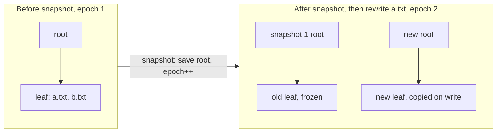

# Stellar FS

`kernel/src/fs/stellar.cpp`. A `Constellation` (directory) is a star whose data is a copy-on-write
B+tree of edges keyed by name hash, so one star can be linked from several directories
with no hard-link special case.

```text
sectors 0 and 1   twin superblocks: magic, version 8, commit number, epoch, catalog root, next star id, snapshot directory
sectors 2..n      free-sector bitmap
sectors n+1..     B+tree nodes (1 sector each), directory sectors, file extents
```

The **catalog** is a disk-backed B+tree keyed by 64-bit star ID (leaf fanout 7, internal
fanout 30). A file is one contiguous extent, or an [extent table](#extent-tables) when no single run fits,
with a CRC32 per 4 KiB block of its data in a [checksum chain](#block-checksums) the catalog entry points to.

### O(1) snapshots via epoch copy-on-write

The superblock holds a global `epoch`. Every catalog node, directory sector and file extent
records the epoch it was written in, and may be modified **in place only if that equals the
current epoch**; otherwise it is copied first (path-copied up to the root for the catalog).



`snapshot()` is three steps: record `{catalog_root, epoch}` in the snapshot table, `epoch++`,
write the superblock. **One sector write, no reads, regardless of tree size**: everything that
existed is now older than the current epoch and becomes copy-on-write on its next change.

A snapshot is a *view*: `find`, `list`, `read_file` and `verify_file` take an optional snapshot
ID (`stellar::LIVE` = 0 is the default), and star IDs are stable across views.

- **File rewrites** allocate a fresh extent. The old one is freed immediately if it was born in
  the current epoch (no snapshot can reference it) and retained if older. Rewriting one file
  300 times with no snapshot in between costs no net space.
- **First write after a snapshot** costs O(log n) node copies in the catalog and O(log n) in the
  directory being written.

### Deletion and reclamation

Each catalog entry carries a link count. `unlink(dir, name)` removes one edge; the star dies when
its last edge goes and its catalog entry is removed, and a non-empty directory is refused. A dead star's extents are returned
immediately if they were born in the current epoch, because no snapshot can reference them.
Anything older stays allocated for the snapshots that may still use it.

`delete_snapshot(id)` removes the snapshot's record from the [snapshot table](#the-snapshot-table). Its ID is never handed out again.
Space is reclaimed by `gc()`, a stop-the-world mark and sweep: it marks the metadata region plus
every catalog node, directory node and file extent reachable from the live root and from each
remaining snapshot root, then rewrites the free bitmap to match. Nothing reachable can be freed,
and sectors leaked by failed operations are recovered as a side effect. It is O(filesystem size) and works in
windows of at most 16 MiB of mark bitmap (64 GiB of disk), see [Free-space bitmap](#free-space-bitmap).

### I/O efficiency

Three things were making the filesystem slow, all fixed: the whole free bitmap was rewritten on
*every* allocation; there was no sector cache, so every B+tree level was a disk round trip; and the
superblock was written for every new star ID. Now only dirty bitmap sectors are written, once per
operation; a 256-slot write-through cache (128 KiB) serves repeat reads; allocation is next-fit with
whole-byte skipping in both directions.

Measured with the host-side harness (131072-sector disk), old implementation vs new in the same harness:

| Operation | Before | After |
|---|---:|---:|
| `create_file` into a directory (avg of 100) | 52.8 writes, 12.1 reads | **6.7 writes, 0.4 reads** |
| Snapshot of a ~120-entry tree | 3,999 writes, 2,742 reads | **1 write, 0 reads** |
| Snapshot of a 700+ entry tree with a 5-deep subtree | recursive copy, grows with size | **1 write, 0 reads** |
| NVMe interrupts during boot self-tests | 271 | **16** |

### Second pass

- **Extents move in batches.** Writes send every whole sector in one batched request and only the
  padded tail sector singly. `read_file` and `verify_file` batch the same way, and a read no longer
  needs an output buffer rounded up to a sector.
- **Group commit.** `begin_batch()` / `end_batch()` hold the bitmap and superblock writes until the
  outermost batch ends. Data and catalog nodes are still written through immediately, so a crash
  inside a batch loses more than a crash between single operations.
- **CRC32 is slice-by-8**, checked against the bitwise reference at every length and alignment.
- **The cache is 256 slots**, so B+tree interior nodes survive a directory walk.

## On-disk format v8

```text
sectors 0 and 1   twin superblocks: magic, version 8, commit number, epoch, catalog root, next star id,
                  feature flags, live snapshot count, snapshot directory sector, next snapshot id,
                  CRC32 in the last 4 bytes
sectors 2..n      free-sector bitmap, 508 bytes of bits per sector plus a CRC32
sectors n+1..     catalog nodes, directory nodes, snapshot table, checksum chains, file extents
                  (every metadata sector ends in a CRC32)
```

Every metadata sector ends in a CRC32 of the sector, verified on every read from disk and stamped on every
write. File data is covered by per-block checksums (below). Catalog entries are 56 bytes (type, sector count, size,
extent, generation, checksum chain, `mtime`, `flags`, link count), so a leaf holds 7. Feature flags in the superblock
gate future layout additions: an unknown *incompatible* bit refuses to mount (`Unsupported`), compatible bits are
ignored. Incompatible bit 0 means "this volume has extent-table files" and is set by the first one; `FLAG_EXTENT_TABLE`
(bit 0 of a star's flags) marks such a file.

**v7 volumes are not migrated.** A v7 superblock is not recognised, so the kernel treats the disk as unformatted and
formats it on the next boot, which destroys its contents. Copy anything you need off a v7 disk first (a v7 build of
`stellarfs cat` can do that).

### The snapshot table

Snapshots are records of `{id, catalog root, epoch}`. The superblock holds only the sector of the **snapshot
directory** and the next snapshot ID. The directory is one sector of up to 61 page pointers, and each page is one
sector of 20 records, so the table holds 1020 snapshots (`SNAPSHOT_MAX`).

- **IDs only go up.** `snapshot()` takes the next ID from a counter in the superblock, so a deleted snapshot's ID is
  never reused and a stale ID can never name a newer snapshot. The counter is part of every commit.
- **Updates are copy-on-write.** Taking or deleting a snapshot rewrites one page and the directory to new sectors in the
  same transaction as everything else, and the old ones are freed after the commit like any replaced node. A page that
  loses its last record is released. The whole table is kept in RAM (about 24 KiB) and only the touched page is written.
- **Cost.** A snapshot is still a constant number of sector writes whatever the size of the tree: a page, the
  directory, a bitmap page and the superblock (measured at 4 to 5 writes and no reads, against 1 write in v7).
- **Damage.** A directory or page failing its CRC, or holding an implausible record (a root outside the data area, an
  ID at or above the counter, a duplicate ID, an epoch from the future), does not stop the mount. The affected
  snapshots are dropped, the table is rewritten, the bitmap is rebuilt from the trees, and the mount logs what it dropped.
  The live filesystem is never affected. An I/O error, as opposed to a bad checksum, still fails the mount.
- `check()` reads the table back from disk, verifies every record against the one in RAM, and counts the table's sectors
  as referenced.

### Block checksums

Each file's data is split into 4 KiB blocks (8 sectors, the last block holds whatever remains), and each block has its
own CRC32. The CRCs live in a **checksum chain**: sectors holding 121 CRCs each, linked by a `next` pointer, built from
the last sector to the first like extent tables, with the head in the entry's `csum_sector` (0 for an empty file).
The chain is allocated with the file, replaced with it, released with it under the same epoch rule, and kept by
snapshots with the old entry.

- **Reads.** `read_file` verifies every block it returns. A read that ends inside a block reads the rest of that block
  into a scratch buffer to verify it, so a partial read is checked too and a corrupt block is refused with `Checksum`
  (the blocks before it still read). Bytes in a file's last sector beyond its size are not covered.
- **Verification.** `verify_file` and the deep `check` stream the data and compare block by block, across extent
  boundaries, and name the first bad block in the log.
- **Chain validation.** The chain must have exactly the number of sectors the size implies, each holding the exact
  number of CRCs, with no early end and no extra tail, or it is `Corrupt`. `check` claims each chain sector.
- **Cost.** One extra sector per 484 KiB of file data (0.2 %), written with the file.
- **Whole-file CRC is gone.** The catalog no longer stores one; a mismatch is now located to a block.

## Crash consistency

A commit is the only thing that makes anything durable, and it is ordered:

1. every data extent and metadata node was already written (but is not yet durable), along with any bitmap page
   the cache had to write early;
2. **flush**;
3. write the dirty bitmap sectors; **flush**;
4. write the new superblock to the slot *not* holding the current one, with a higher commit number; **flush**;
5. only now free the sectors the commit replaced, and write that bitmap update (best effort).

Every commit starts a new epoch, so a node that has been durable is never modified in place: it is copied, and the
old copy is freed according to when it was born. Born in the current epoch (never durable) means free it now;
born earlier, with no snapshot taken since, means free it after the next commit succeeds; otherwise a snapshot may
still see it and it is kept until `gc()`. The on-disk bitmap is therefore always a superset of what the durable
superblock references, so a crash can leak space (which `gc()` or a damaged-mount rebuild reclaims) but can never
hand out a sector that is still in use.

Mount takes the valid superblock with the higher commit number. If a superblock slot or a bitmap sector fails its
checksum, the bitmap is rebuilt from the trees before the filesystem is used. A failed operation that changed
anything is **rolled back** by reloading the durable state, so it leaves no partial result; a failure inside a
`begin_batch`/`end_batch` group rolls the whole group back, and `end_batch` reports it. A group that only contained
validation failures (`Exists`, `NotFound`, ...) is not affected.

**How this is tested.** The host harness records every sector write and flush barrier of a random 64-operation
workload (creates, rewrites, unlinks, links, snapshots, `gc`, batches). At every cut point it builds disks from a
random subset of the writes issued since the last barrier, applied in random order and sometimes with one of them
replaced by garbage (a torn write), mounts each, and requires that the result is exactly the state before or after
the operation that was in flight, that `check()` finds nothing wrong, and, for a fifth of them, that `gc()`, a new
write and a remount all work. The default run covers about 6000 states. Deliberately wrong protocols are rejected:
writing the bitmap after the superblock fails over a thousand of 2900 states; starting no new epoch, freeing
replaced sectors immediately, and making `flush()` a no-op each fail the suite.

**Assumptions.** A single 512-byte sector write is either applied or not, or is detected by its CRC if torn; the
device honours `flush()`. Not modelled: a device that acknowledges a flush without making the data durable, and
silent corruption that happens to preserve a CRC.

### Crash testing

Three layers, in decreasing order of how much they control and increasing order of how real they are:

1. **The write-log simulation** (above). Every crash point of a random workload, with the unflushed writes applied as
   an arbitrary subset, in any order, some torn. It starts from an already formatted disk, so it says nothing about
   `format`.
2. **Crash during format.** The same idea applied to `format()` itself, from a blank disk: every cut point, 24
   recoveries per cut (ordered prefix, nothing, and random subsets of the unflushed window). The requirement is that
   a disk either mounts with its root directory and checks clean, or is `NotFormatted` and safe for the kernel to
   format again. This found two bugs, below.
3. **`tools/crash-fuzz.sh` (`make crash-fuzz`).** Boots the real kernel under QEMU on a real driver, kills the
   emulator with SIGKILL, runs the host `fsck` on a copy of the crashed disk, and every few rounds boots the crashed
   disk to completion and requires every self-test to pass and `fsck` to stay clean. Every fourth round starts from a
   blank disk, throttled to 200 IOPS and killed 0 to 90 ms after the kernel prints that it is about to format, so the
   kill lands inside the format; the other rounds kill at a uniformly random instant of the first 4.5 seconds.

What layer 3 does **not** show. Killing an emulator produces only crashes that are an in-order prefix of the writes
the guest had issued: nothing is reordered, torn, or lost from a device cache, because the host keeps everything the
guest wrote. So it does not test whether the kernel's flush ordering is right (layer 1 does, in simulation) or
whether a real device honours `flush()` (nothing here does). Kill times are seeded, but QEMU's own timing is not, so a
run cannot be replayed exactly; a failing run keeps the crashed disk image, which is the reproduction.

What it found, and what it missed:

- It found that the kernel's boot self-test assumed a pristine disk: it hard-coded the number of entries in the root
  directory, so a boot killed during the SMP stress left a `smpstress/` directory that made the next boot skip its own
  test. The filesystem was fine; the test was wrong. The test now removes the stale directory and counts only entries
  that exist.
- Uniformly random kill times never found the format bug: about 60 kills against the build without the fix (two
  of three runs stopped early on the self-test problem above), none in the window, because the whole format takes a millisecond or two and a shell cannot aim that finely. The deterministic
  layer-2 test found it first. The fuzzer found it only after the disk was throttled and the kill was keyed to a log
  line, and then 14 of 16 aimed kills against the old build produced the bad state.
- It also found two bugs in itself: `od` collapses repeated lines, which made a blank sector look non-empty, and a
  guard that waited for a log line printed 0.6 seconds before the format began.

**Format is now crash-safe.** It used to write the zeroed bitmap before any superblock existed, so a crash there left
a disk with data but no Stellar marker, which the format guard (correctly) refuses to overwrite: the kernel would
never have formatted it again. It also made an empty-catalog superblock durable before creating the root directory in
a separate transaction, so a crash between them left a volume that mounted but had no root. Now both superblock
slots are first overwritten with the Stellar magic and no valid version (and flushed), the bitmap is written, and the
root directory is created inside the same commit that makes the first superblock durable; the second slot is
mirrored afterwards. Crashing at any of the 14 writes leaves either a marked disk the kernel reformats or a complete
volume.

**On real hardware.** None of this has been run on a physical disk. A power cut is the only test of the device
assumptions above. If you try it, use a spare disk that holds nothing you want (the kernel formats a blank disk and
an unmarked non-blank one is refused), cut power while it is booting or while the stress test runs, then attach the
disk to another machine and run `build/stellarfs fsck /dev/sdX`. Expect a clean result with, possibly, some leaked
sectors (harmless, `gc` returns them). `referenced-but-free` or bad checksums on a committed file would be a real finding.

## Verification and hardening

`check(report, deep)` walks the live tree and every snapshot and reports bad checksums, bad file data, referenced
sectors the bitmap says are free (the dangerous case), leaked sectors, wrong link counts, dangling or malformed
directory entries, sectors referenced twice, and malformed nodes. Reads also defend themselves against stale or
wrong structure that a CRC cannot catch: node entry counts are bounded, sector numbers must lie in the data area,
and directory trees and tree recursion have cycle and depth limits. Those limits were added after mutation testing
of the crash harness produced a stack overflow from a cyclic tree.

## Directory tree

A directory is a copy-on-write B+tree stored in the same kind of sectors as the catalog and under the same
epoch rule: a node is modified in place only if it was born in the current epoch, otherwise it is copied and the
copy is linked in along the path to the root. A directory star's catalog entry holds the tree root in
`first_sector` and its parent directory in `size_bytes` (`stat` reports 0 for directories); the root directory's
parent is `INVALID_STAR`. The parent pointer is what lets a later `rename` refuse to move a directory under its
own descendant without walking the subtree.

**Keys.** An entry is `(key, star, name[52])`, 68 bytes, 7 per leaf; internal nodes are the catalog's, 30-way.
The key is the top 48 bits of the name's hash followed by a 16-bit ordinal, so keys are unique and all names with
the same 48-bit prefix sit next to each other. A lookup seeks to the first key with that prefix and compares real
names along the run, so a hash collision can never return a wrong answer; creating a name takes the lowest free
ordinal in its run. A run can hold 65536 names, after which a create reports `NoSpace`. The hash (FNV-1a with a
final mix) is now part of the on-disk format and is not keyed, so a determined user can build colliding names.
Listings come out in hash order.

**Cost.** Lookups, creates and unlinks descend one path. With fanouts of 7 and 30 the tree is 3 levels at 1000
entries and 4 at around 100,000 (computed from the fanouts, not measured). The first write after each commit copies that path, not the directory. Measured in the host
harness, a single-operation create (one commit each) costs 10.5, 13.4 and 13.6 sector writes into directories of
100, 400 and 1000 entries; the chain it replaced cost 25.9, 70.7 and 156.7. Snapshot views use the same lookup, so
there is no per-snapshot filter and no RAM index, and no directory operation allocates RAM.

**Delete.** An unlink removes the entry from its leaf, and the same routine removes catalog entries. Every node
except the root is kept at least half full: a leaf holds at least 3 entries and an internal node at least 14 keys.
When a removal leaves a node below that, it is merged into a neighbour if the two fit in one node, otherwise the
entries are redistributed between them and the separating key is updated; either way it goes through the usual
copy-on-write and epoch rule, so the sector of a merged-away node is returned immediately or deferred exactly like
any other replaced node. A merge can leave the parent short in turn, and the root is collapsed when it is left with a
single child. A completely empty tree is one empty leaf. Trees written by older kernels can contain sparse nodes;
they are repaired only where a removal touches them.

`check()` walks every directory tree with key bounds (every key must lie between its parent's separators and be
strictly ascending), verifies each key's prefix against its name's hash, each entry's target, and each
subdirectory's parent pointer, and counts the edges that feed the link-count check.

## Status codes

Every operation that can fail takes an optional trailing `Status* why`. The return value keeps its old shape
(`bool`, a star ID or `INVALID_STAR`), and `*why` says which of these happened: `NotMounted`, `NotFormatted`,
`InvalidArgument`, `InvalidName`, `NotFound`, `Exists`, `NotADirectory`, `IsADirectory`, `NotEmpty`,
`NoSpace`, `NoMemory`, `Io`, `Checksum`, `Corrupt`, `Busy`, `NoSuchSnapshot`, `TooManySnapshots`, `Unsupported`, `WouldCycle`. `Internal`
means a failure path forgot to say why; the tests assert it never appears. It is an out-parameter rather than
the return type because `Ok` is 0, so a function returning `Status` would silently invert every existing
`if (!unlink(...))`.

`read_file` returns `READ_ERROR` (`INVALID_STAR`) on failure. `0` now only means a legitimately empty read, and
a checksum mismatch is `READ_ERROR` with `Checksum`. Names must be 1 to 51 bytes with no `/`, and `.` and `..`
are refused; duplicates are refused with `Exists`.

`resolve("/a/b/c")` walks a path from the root in any view, and `resolve_parent` splits a path into the parent
directory and a validated leaf name. Repeated and trailing slashes are accepted (a trailing slash requires a
directory), and relative paths, `.` and `..` are refused because directories keep no parent pointer.

## Extent tables

A file is one contiguous run of sectors whenever one exists, exactly as before. Only when no single run is long
enough does the file become an **extent-table file**: its catalog entry has `FLAG_EXTENT_TABLE` set, `first_sector`
points at the head of a chain of table sectors, and `sector_count` is the total number of data sectors.

```text
table sector   next table (0 = last) | gen | count | 40 x (start sector, sector count) | CRC32
```

- **Allocation.** The allocator asks for the whole file first. If that fails and the disk has enough free sectors in
  total, it asks for half, then a quarter, and so on, so large extents are used wherever they exist; adjacent pieces
  are merged. Then it writes the data, then the table sectors from the last to the first (so each knows its `next`),
  and the head is what the catalog entry points to. A failure at any point is rolled back with the rest of the
  operation, so there is no cleanup code to get wrong.
- **Tables are immutable.** A file is only ever replaced (`write_file` allocates a new layout), so table sectors are
  written once and never copied on write. They are released with the file, under the same epoch rule as its extents,
  and snapshots keep both the old extents and the old table.
- **Reading.** `read_file`, `verify_file`, the deep `check`, gc marking and release all walk the chain through one
  function that validates as it goes: 1 to 40 extents per table, every extent inside the data area, the extents
  summing to exactly `sector_count`, and no more tables than the file could need, so a table that loops or is cut short
  is refused with `Corrupt` instead of followed or returning short data.
- **Compatibility.** The first extent-table file sets incompatible feature bit 0 in the same commit. Older code
  refuses a volume with that bit (`Unsupported`, never reformatted), which was checked against the previous build.
  The bit is never cleared, even if every such file is later deleted. The boot self-test creates and removes one, so
  **the first boot of a kernel with this change marks the volume** and an older kernel can no longer mount it.
- **Limits.** Space for the table sectors is only found after the data, so a file that needs every free sector
  gets `NoSpace` (and leaks nothing) even though its data would fit. `stat` reports the extent count. Reads go front to
  back through the chain; there is no seek, which no current interface needs.

**Tests.** A disk fragmented into runs of one sector (709 free sectors, where a 40-sector file used to fail with
`NoSpace`) takes a 40-sector file, and a file that needs every free sector is refused with `NoSpace` and leaks nothing. A test hook that caps extent length gives exact extent and table
counts (1, 2, 39, 40, 41, 80, 81, 120, 121) and reads of every length across boundaries. The file is rewritten between
contiguous and table form, under snapshots, with hard links, and over gc windows. Seven on-disk corruptions of a table
are each found by `check` and refused by `read_file`: a bad checksum, a sum that is too high or too low, overlapping
extents, a chain that loops, a chain cut short, and an extent inside the metadata area. Two model-based fuzz runs (2,500
operations with a forced cap, 1,500 on a nearly full disk where table files arise on their own) check every file after
every change and found no mismatch. Two more crash-exploration configurations (a
forced cap, and a naturally fragmented nearly-full disk, 5,481 crash states together) recover exactly; the
fail-every-write table covers table create, rewrite and unlink. Six mutations of the code each fail the suite: a
walker that no longer checks the extents add up, a release that forgets the table sectors, a gc that does not mark them,
extents written from the wrong buffer offset, a feature bit that is never set, and a rewrite that keeps a stale table flag.

## Rename

`rename(src_dir, src_name, dst_dir, dst_name, flags)` and `rename_path(from, to, flags)` move an entry between
names and directories in one transaction, so a crash leaves the old name or the new one and never both or neither.
The star keeps its ID, size, link count and `mtime`; only the edge moves. Snapshots keep showing the old name where
it was.

- **Replacing.** If the destination exists it is replaced atomically. A file replaces a file, a directory replaces
  an *empty* directory; a file over a directory is `IsADirectory`, a directory over a file `NotADirectory`, over a
  non-empty directory `NotEmpty`. The replaced star goes through the same death-or-link-count path as `unlink`, so
  replacing one of two hard links leaves the other intact. `RENAME_NOREPLACE` turns any existing destination into
  `Exists`.
- **No-ops.** Renaming a name onto itself, or onto another name of the same star, succeeds and changes nothing.
- **Cycles.** Moving a directory into itself or any descendant is `WouldCycle`. The check walks the destination's
  parent pointers up to the root, so it costs the depth of the destination, not the size of the moved subtree. A
  moved directory's parent pointer is rewritten in the same transaction, and `check()` verifies it.
- A rename does not update the `mtime` of either directory.

## Free-space bitmap

The on-disk bitmap is unchanged: one bit per sector, 508 bytes of bits plus a CRC32 per sector ("page", 4064
sectors of disk each). What changed is that it is no longer held in RAM.

- **Page cache.** 64 slots (32 KiB). Dirty pages stay in a slot until the commit writes them; if one transaction
  dirties more pages than there are slots, the least recently used dirty page is written early. That is safe for
  the crash model: RAM never clears a bit the durable state references before the commit (those frees are
  deferred), so any page image is a superset of what is durable and the worst outcome of a crash is a leak that
  `gc()` recovers. Early writes need a group commit or a very large file; a single create dirties about as many
  pages as the extent spans (a 40 MiB file: 20 pages). The commit flushes the device if any early write happened.
- **Summary.** A 16-bit count of free data sectors per page, built while mounting and kept exact by every
  allocate and free. Allocation skips full pages without reading them and takes a completely free page without
  reading it either, so a fresh disk is searched without touching the bitmap. `free_space_sectors()` sums the
  counts. RAM is 3 bytes per page, 1.5 MiB per TB.
- **Batched I/O.** Mount and `format` move the bitmap 32 sectors per device command, with a fallback to single
  reads. `gc()` and `check()` read it through a streaming reader that prefers a cached (possibly dirty) page and
  does not disturb the cache.
- **Windowed gc.** The mark bitmap covers at most 16 MiB at a time (64 GiB of disk); a larger disk is processed in
  windows, re-walking the trees for each one. A disk of up to 64 GiB is one window, as before.
- **Damaged pages.** A page failing its checksum at mount is flagged, counted as free, and rebuilt by the gc that
  mount runs; it is rewritten even when its rebuilt contents are all zero.

Measured with `make bench-stellar` on sparse virtual disks (host RAM disk, so device commands are the figure that
carries over; before is the fully resident bitmap):

| 8 GiB disk | Before | After |
|---|---:|---:|
| Bitmap RAM | 2,068 KiB | 61 KiB |
| `format` device commands | 4,137 | 140 |
| `mount` device commands | 4,131 | 132 |
| `free_space_sectors()` (one call) | 16 ms | a few microseconds |
| `gc()` device commands | 96 | 229 |
| `check()` device commands | 22 | 151 |

`gc` and `check` now read the bitmap, which they did not have to when it was resident, so their command counts went
up; the first version of this change did that one page per command (4,226 and 4,087) and the streaming reader is what
brought it back. Extrapolated linearly to 1 TB, the resident bitmap would have been 258 MiB plus another 258 MiB for
a gc mark; now it is 1.5 MiB plus the 32 KiB cache.

**How it is tested.** The same randomized workload on a 40,000-sector disk, run with a 64-slot cache, a 1-slot
cache, and a 2-slot cache with 1-page gc windows, produces byte-identical disk images. The crash exploration has a
fourth configuration (a 3-page disk with a 1-slot cache, 2,650 crash states) in which early writes really happen.
A 2 GiB disk takes five 40 MiB files in one group commit (38 early writes), remounts, and windowed gc runs over
eleven windows. Mount is tested against an unreadable bitmap sector, failing batched reads, and a damaged page that
holds only free space. Every one of five mutations (dropping a dirty page on eviction, a wrong free-page shortcut, a
summary that forgets frees, a gc window offset error, and a damaged page that is not forced to rewrite) fails the
suite.

## Mount and format policy

`mount()` never formats. The kernel formats a disk only when `mount()` reports `NotFormatted` **and**
`can_auto_format()` agrees: the first 64 sectors are all zero, or sector 0 or 1 carries the Stellar magic (an
older on-disk version, which is reformatted on purpose). Every other outcome (`Corrupt`, `Unsupported`, `Io`, a
disk holding someone else's data) leaves the disk untouched and boots without a filesystem. The block-device
self-tests that write the last 64 sectors only run when a Stellar volume is mounted and stops short of them. The
probe looks at the first 64 sectors only, so data that starts later on a disk whose first 32 KiB are zero is not
detected. `stellarfs mkfs` and `format()` are explicit calls and are not guarded.

## Concurrency

Every public function takes one recursive `orbital::Mutex` (owned by the Satellite, not the core), and
`begin_batch` holds it until `end_batch`, so one thread's group commit cannot interleave with another's.
`mount` and `format` refuse to run while a batch is open. Each block driver has its own mutex around its HAL
entry points, always taken after Stellar's. There are no sleeping locks yet: a contended waiter yields and
sinks to the lowest scheduler ring so a runnable holder always outranks it.

---

## Known limitations

Stated plainly:

- Crash safety rests on the assumptions listed above. It has been tested by simulation and by killing the kernel
  under QEMU (in-order prefixes only), never on hardware.
- **gc() is stop-the-world**, O(filesystem size): it holds the filesystem lock for its whole run. Space held
  by older epochs only comes back via `delete_snapshot` and `gc()`. On a disk over 64 GiB it walks the catalog
  once per window (and once per snapshot root per window), so cost grows with disks x snapshots x catalog size.
- Star IDs are never reused, so a snapshot's view of a star can never be confused with a later star. A dead star's
  catalog entry is removed from the live catalog when its last link goes; snapshots keep their own copy for as long as
  they live. Entries left behind by earlier kernels (a catalog entry of type `TYPE_FREE`) are removed by the next `gc()`,
  which logs how many it purged.
- The snapshot table holds 1020 snapshots; IDs are never reused, so a long-lived volume that creates and deletes many
  snapshots keeps counting up (a 64-bit counter, which cannot realistically run out).
- Snapshots are **whole-filesystem**, not per-subtree.
- A name hash prefix holds at most 65536 names. Directory listings are in hash order, not creation order.
- Concurrency is tested on host threads (a four-thread create/find/list/snapshot test and a four-thread `rename` test that
  checks for lost, duplicated and misplaced entries) and on the kernel's own scheduler: the boot-time SMP stress has four
  Satellites create files in one directory, move each to a second directory and back with `RENAME_NOREPLACE`, contend
  on one shared file by renaming it between the two directories, and then verify every entry, remove everything and run
  `check()`. The host tests run on real pthreads under ThreadSanitizer (`-fsanitize=thread`); the kernel run has no race
  detector.
- Free space is a bitmap, not the Universe/Orbit buddy machinery. Mount reads all of it (in 32-sector commands)
  to build the page summary, so mount time is linear in disk size: about 130 commands per 8 GiB.
- `check()` runs in windows: each pass covers 32 GiB of data area (two 8 MiB bit arrays) and 2M stars (16 MiB of
  link counters), and re-walks the trees for every window, so its RAM is fixed and its time grows with the number of
  windows times the metadata size. The windows are set by `test_set_check_window`, and the host tests require the
  report to be identical to a single-pass check on clean and on damaged images.
- A failure to read a bitmap page while freeing sectors leaves them marked used (a leak that `gc()` recovers). If the
  free happens inside the operation, the operation fails with `Io` and is rolled back. If it happens after the commit
  is already durable (the deferred frees of replaced sectors), the operation has succeeded and cannot be undone, so the
  failure is logged on the serial console and counted by `free_failures()`. If the page stays unreadable, the rollback
  itself cannot reload the volume and it is left unmounted.
- Block checksums cover file data and the chain that holds them is checksummed per sector, but nothing protects against
  a block and its checksum being replaced together by an older consistent pair (that needs a hash tree, which this is not).
- Bumping the superblock version reformats an existing disk on next boot: v7 and earlier volumes are not migrated.
- The boot self-tests that take snapshots are skipped on a mounted disk to avoid exhausting the table.

---
